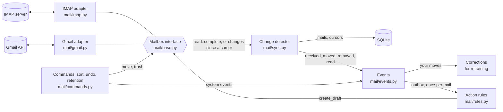
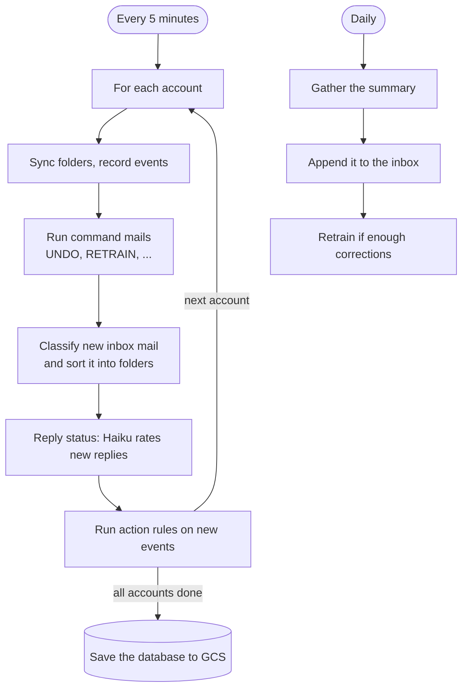

# SMIO – Smart Mail Inbox Organizer

An AI-powered system that automatically analyzes, categorizes, and declutters your email inbox.

SMIO connects to one or more mailboxes (IMAP or Gmail), classifies incoming mails with a fine-tuned DistilBERT model, moves them into the folders of a configurable folder list, extracts delivery details with a custom NER model, reacts to mail events with configurable action rules (for example, a reply draft written by Claude Haiku), sends you a daily plain-language summary, and retrains the classifier on your manual corrections.

---

## 📌 Features

- **AI-based email classification** — sorts mail into the folders of a configurable [folder list](#folder-lists), one fine-tuned DistilBERT model per list; mail that fits no folder stays in the inbox as `other`.
- **Several accounts and providers** — IMAP and Gmail behind one [mailbox interface](#-how-it-works); each account uses one folder list. Exchange is planned.
- **Delivery extraction** — for lists with a `delivery` folder, identifies tracking and order details with a token-classification NER model and rule-based fallbacks.
- **Inbox automation** — files messages by folder, applies read/unread retention rules, records manual folder moves as corrections, and supports undo.
- **Events and action rules** — every change of a mail (received, moved by you or by SMIO, removed, read) becomes an event; [action rules](#action-rules) react to them, for example with a reply draft written by Claude Haiku. Each action runs at most once per mail.
- **Reply status** — Claude Haiku reads replies in a thread and updates the status of the mail they answer (to do, waiting for an answer, a date or a document, done).
- **Email commands** — accepts `UNDO [n]`, `RETRAIN`, `RELOAD MODEL`, `RESTORE MODEL`, `LOGS <1-2000>`, and `SUMMARY` from the configured mailbox; commands are moved to Trash before execution, with failure notices for errors and timed-out attempts.
- **Daily summaries** — stores logical-day snapshots, delivery details, and retraining status. Display dates use `DD/MM/YYYY`; seed training data is excluded from mailbox counts.
- **Replay-buffer retraining** — learns from manual corrections mixed with earlier labeled mail, discards rejected candidates, and promotes only when macro-F1 is no worse, the paired-bootstrap 95% lower bound is within a 2-point non-inferiority margin, and no class with at least 10 holdout examples loses more than 10 points of recall. Replaced models are archived in GCS for seven days and can be restored by email command.
- **Local and cloud operation** — run locally or on Cloud Run with Cloud Scheduler; Cloud Run loads the classifier from GCS, while local images include a classifier fallback.

## 🧠 Core technologies

- Python 3.x, PyTorch, Hugging Face Transformers, scikit-learn
- FastAPI and SQLAlchemy with SQLite
- `imap-tools` for IMAP, the Gmail API (REST with `google-auth`) for Gmail
- Anthropic Claude Haiku for reply status and reply drafts (optional)
- Google Cloud Run, Cloud Scheduler, Cloud Storage and Secret Manager (optional)

## 📬 How it works

### The mail layer

Providers differ only in a thin adapter. Everything above it, from change
detection to actions, is shared, so a new provider (such as Exchange) only needs
an adapter.



- **Adapters** only translate. They read folders (Gmail: labels) and run commands
  (move, trash, append, create a draft). Gmail lists only message ids; content is
  fetched for mail SMIO has not stored yet, at most `SMIO_SYNC_MAX_FETCHES` per run.
- **The change detector** compares what it reads with the database. It reads each
  folder completely every `SMIO_FULL_SYNC_MINUTES`, otherwise only what arrived
  since the folder's cursor (IMAP: UIDNEXT; Gmail: the history id). Only a complete
  read can tell that a mail left a folder or was read.
- **Events** record every change in the same transaction as the change itself,
  with `source: user` (found on the server) or `system` (done by SMIO). SMIO's own
  commands write their change at once, so the server's echo is no new event. Your
  moves into a folder of the list are corrections for the next retraining.
- **Actions** run from the event outbox after the change is saved, at most once
  per mail and rule. Mail found by an account's first sync triggers none.
- **SMIO's own mails** (summaries, notices) carry the header `X-SMIO-Mail` and are
  never classified; mail from the account's own address otherwise is.

### The workflow



1. **Sync** — each account's watched folders are read and reconciled, and retention moves old mail to the trash ([src/mail/sync.py](src/mail/sync.py), [src/mail/commands.py](src/mail/commands.py)).
2. **Commands** — mails with a command are moved to the trash, then run ([src/api/utils/command_processor.py](src/api/utils/command_processor.py)).
3. **Process** — new inbox mail is classified with the model of the account's folder list, NER runs for `delivery` mails, and the mail is moved into its folder ([src/api/utils/inbox_processor.py](src/api/utils/inbox_processor.py)).
4. **Reply status** — Claude Haiku decides what a reply means for the mail it answers ([src/ai/reply_status.py](src/ai/reply_status.py)).
5. **Actions** — configured rules run on the new events ([src/mail/rules.py](src/mail/rules.py)).
6. **Summarize and retrain (daily)** — the logical day's snapshot is stored and its digest appended to the inbox. The model section and technical details appear only after a retraining ran in that period. Retraining starts once enough manual corrections have accumulated: it fine-tunes the classifier on a replay buffer (90% old data / 10% new corrections per class) and applies the macro-F1, paired-bootstrap and per-class recall gates on a fixed hold-out set, then mails the result. Automatic retraining covers the `default` list's model; models of other lists are trained with `scripts/train_distilbert_optuna.py --folder-list <list>` and uploaded to `models/classifier-<list>` in GCS.

---

## 📂 Project structure

```text
SMIO/
  src/
    ai/                 # classification, NER, summaries, retraining
    api/
      routers/          # inbox, mail sync, summary, scheduled jobs
      utils/            # email commands, folder rules, email delivery
    db/                 # database engine, migrations, ORM models
    mail/               # mailbox interface, IMAP and Gmail adapters, sync,
                        # events, action rules, drafts, sorting/undo/retention
    scheduler/          # scheduled workflow orchestration
    storage/            # Google Cloud Storage and Secret Manager integration
  scripts/              # deployment, data import/export, training, maintenance
    deploy.ps1
    add_account.ps1
    update_ner_model.py
    sync_database_with_gcs.py
    run_workflow.py
    backfill_summary_snapshots.py
    bootstrap_eval_holdout.py
    evaluate_classifier.py
    export_ner_from_db.py
    export_training_data.py
    import_training_data.py
    test_classifier.py
    train_bert_classifier.py
    train_distilbert_hparam_cv.py
    train_distilbert_optuna.py
    train_ner.py
  models/
    distilbert_deployed/       # model of the "default" folder list
    classifier-<list>/         # model of any other folder list
    distilbert_optuna/
    distilbert_candidate_*/
    ner-smio/
  data/
    raw/
    labeled/
  training_data.jsonl
  ner_training.jsonl
  Dockerfile
  requirements.txt
  requirements-runtime.txt
```

---

# 🚀 Getting started

### 1. Clone the repository
```bash
git clone https://github.com/yourname/SMIO.git
cd SMIO
```

### 2. Create a virtual environment
```bash
python -m venv smio
smio\Scripts\activate      # Windows
source smio/bin/activate   # macOS/Linux
```

### 3. Install dependencies
```bash
pip install -r requirements.txt
```

### 4. Start the FastAPI server
```bash
uvicorn src.api.main:app --reload
```
API available at http://localhost:8000

### Docker
Build the API image (the `.env` file is deliberately excluded; pass secrets as environment variables):

```bash
docker build -t smio:local .
docker run --rm -p 8080:8080 --env-file .env smio:local
```

The default `local` image includes the checked-out classifier and NER models. The
Cloud Run target omits both models and loads them from GCS. Docker installs the
CPU-only `requirements-runtime.txt`; the full `requirements.txt` remains for local
training and evaluation. Ensure the classifier prefix exists and upload the NER
model with `-UpdateNerModel` on the first migration. The container serves the API
at `http://localhost:8080`. Configure
Cloud Run environment variables through Secret Manager or service configuration; do
not add `.env` to the image.

The bundled `config/smio.yaml` reads the IMAP password from Secret Manager
(`password_secret`), which a local container cannot do without Google credentials.
For a local container, mount a config whose account uses `password: ${IMAP_PASSWORD}`
instead and point `SMIO_CONFIG_PATH` at it:

```bash
docker run --rm -p 8080:8080 --env-file .env \
  -v "$PWD/smio.local.yaml:/app/config/smio.local.yaml:ro" \
  -e SMIO_CONFIG_PATH=/app/config/smio.local.yaml smio:local
```

### Local operation without Google Cloud

Google Cloud Storage is optional. For a local PC or Raspberry Pi, leave
`GCS_BUCKET` unset. SMIO then uses the checked-out files directly:

- classifier: `models/distilbert_deployed`
- NER model: `models/ner-smio`
- SQLite database: `./smio.db`
- retraining state and candidates: `models/`

Before the first run on a new machine, install Git LFS and hydrate the model
files. Otherwise Git may leave large model files as small LFS pointer files:

```bash
git lfs install
git lfs pull
```

Then create a local `.env` containing the IMAP settings. The repository's
[config/smio.yaml](config/smio.yaml) reads the IMAP password from Secret Manager;
without Google Cloud, replace `password_secret: imap-password` there with
`password: ${IMAP_PASSWORD}`. Start the API from the repository root:

```bash
uvicorn src.api.main:app --host 0.0.0.0 --port 8080
```

Do not set `GCS_BUCKET` in local mode. After local retraining promotes a model,
the changed Git LFS file can be reviewed and versioned normally:

```bash
git add models/distilbert_deployed
git commit -m "Update deployed classifier model"
git push
```

### Cloud Run and Cloud Scheduler
The summary uses a logical day from `08:00` to the next day `08:00` in
`Europe/Berlin`. The default start hour and timezone can be changed with
`SMIO_SUMMARY_START_HOUR` and `SMIO_SUMMARY_TIMEZONE`. The scheduled daily job
runs at the same configured start time and stores the gathered data in the
`summary_snapshots` database table before sending and retraining.

The API exposes these scheduler/action endpoints:

| Method | Path | Schedule | Work |
|---|---|---|---|
| POST | `/jobs/five-minute` | Every 5 minutes | Per account: sync, command mails, classify and file new mail, reply status, action rules |
| POST | `/jobs/daily` | Daily | Gather, send, then retrain |
| POST | `/jobs/daily/gather` | Manual | Gather and store one summary date (`force=true` can overwrite an older snapshot) |
| POST | `/jobs/daily/send` | Manual | Send the stored summary for one date |
| POST | `/jobs/daily/retrain` | Manual | Run retraining if the correction threshold is met |

For manual `gcloud` commands, set `GCP_PROJECT_ID`, `GCP_REGION`, and optionally
`GCP_SCHEDULER_LOCATION` in your shell from `.env` first. For a manual source
deployment, keep both the Cloud Run instance count and request concurrency at one
while SQLite is stored in GCS:

```bash
gcloud run deploy smio \
  --source . \
  --project="$GCP_PROJECT_ID" \
  --region="$GCP_REGION" \
  --no-allow-unauthenticated \
  --max-instances=1 \
  --concurrency=1 \
  --timeout=3600 \
  --set-env-vars=GCS_BUCKET="$GCS_BUCKET",GCS_CLASSIFIER_MODEL_PREFIX=models/distilbert_deployed,GCS_DATABASE_OBJECT=databases/smio.db
```

Set the IMAP values (and optionally `ANTHROPIC_API_KEY`) with Secret Manager rather
than command-line environment variables or `.env`. `scripts/deploy.ps1` asks for any of
the secrets `imap-host`, `imap-user`, `imap-password` and `claude-api-key` that do
not exist yet (passwords and keys hidden) and creates them. `imap-host`, `imap-user`
and `claude-api-key` are bound to the service as environment variables; account
passwords are read by SMIO itself at login (see
[Mail accounts and credentials](#mail-accounts-and-credentials)). Give the Cloud Run service account read/write access to the GCS bucket.
Create a dedicated scheduler service account, grant it `roles/run.invoker` on the
`smio` service, then create the schedules with an OIDC token:

```bash
SCHEDULER_LOCATION="${GCP_SCHEDULER_LOCATION:-$GCP_REGION}"

gcloud scheduler jobs create http smio-five-minute \
  --location="$SCHEDULER_LOCATION" \
  --project="$GCP_PROJECT_ID" \
  --schedule="*/5 * * * *" \
  --uri="https://YOUR_CLOUD_RUN_URL/jobs/five-minute" \
  --http-method=POST \
  --oidc-service-account-email=YOUR_SCHEDULER_SERVICE_ACCOUNT

gcloud scheduler jobs create http smio-daily \
  --location="$SCHEDULER_LOCATION" \
  --project="$GCP_PROJECT_ID" \
  --schedule="0 8 * * *" \
  --time-zone="Europe/Berlin" \
  --uri="https://YOUR_CLOUD_RUN_URL/jobs/daily" \
  --http-method=POST \
  --attempt-deadline=30m \
  --oidc-service-account-email=YOUR_SCHEDULER_SERVICE_ACCOUNT
```

Cloud Scheduler's HTTP deadline is limited to 30 minutes. If retraining can exceed
that, move the retraining part of the daily routine to a Cloud Run Job; do not let a
long training request be retried while it is still running.

## Scripts and Operations

Run these commands from the repository root.

### Deploy to Cloud Run

[scripts/deploy.ps1](scripts/deploy.ps1) reuses an active Google Cloud SDK login
(or prompts for login if needed), starts Docker Desktop if it is not running, and
waits for the Docker engine before building and pushing the image to Artifact
Registry. It applies the cleanup policy in [scripts/artifact-cleanup-policy.json](scripts/artifact-cleanup-policy.json)
(keep the newest two images, delete older ones after 1 day). It grants the runtime service account access to Secret Manager and GCS,
and read-only Cloud Logging access for the `LOGS` email command. It then deploys
Cloud Run with the required single-instance SQLite settings.
Before deploying, it pauses the configured daily and five-minute Scheduler jobs,
asks you to confirm in-flight workflows have finished, and backs up the existing
GCS database to a timestamped object under `backups/`. It resumes only the jobs it
paused, including when deployment fails. Jobs already paused remain paused.
The deploy defaults are 2 vCPU and 8 GiB memory to support CPU retraining.

```powershell
.\scripts\deploy.ps1
```

Add `-UpdateNerModel` to upload `models/ner-smio` as a new immutable GCS release
and deploy a Cloud Run revision pinned to it. Use `-NerModelDirectory` to choose a
different trained model directory.

Daily summaries are appended directly to the account's inbox. The deploy
script reads `GCP_PROJECT_ID`, `GCP_REGION`, and `GCS_BUCKET` from `.env`;
`GCP_SCHEDULER_LOCATION` is optional and defaults to `GCP_REGION`. Explicit
script parameters override `.env` values.

The service gets no `IMAP_PASSWORD` variable. If the bucket holds a
`config/smio.yaml` from an earlier version whose primary account uses
`password: ${IMAP_PASSWORD...}`, change that line to `password_secret: imap-password`
(or delete the object so the bundled config is uploaded) before deploying.

### Add a mail account

```powershell
.\scripts\add_account.ps1
```

The script asks for the account id, IMAP host, username and password (hidden),
stores the password as the secret `imap-<id>-password` (a new version if the secret
exists), and prints the entry to add under `accounts:` together with the
`gcloud storage cp` commands that download and upload the service's config. The
next workflow run picks the account up; no redeploy is needed. `-Email` sets the
account's address if it differs from the username, `-FolderList` its folder list,
and `-GcsBucket` overrides `GCS_BUCKET` from `.env`. Run it again with the same id
to change a password.

A Gmail account needs a Google login instead of a password:

```powershell
.\scripts\add_account.ps1 -Provider gmail -AccountId gmail-me -FolderList logistics
```

Once per project, in the Google Cloud console's Google Auth Platform: set up the
app (Audience "External", then "Publish app" so it is "In production"; in
"Testing" a login expires after 7 days), add the scope
`https://www.googleapis.com/auth/gmail.modify` under Data Access, and create a
client of type "Desktop app" under Clients. The scope may stay unverified for
personal use; Google then warns at the login ("Advanced", then "Go to ... (unsafe)").

The script asks for the client ID (or reads `GMAIL_CLIENT_ID`) and, the first time,
the client secret, enables the Gmail API, opens the browser for the login, checks
that the mailbox is `-Email` if given, and stores the client secret as
`gmail-client-secret` and the refresh token as `gmail-<id>-refresh-token`. Run it
again after revoking SMIO's access or changing the Google password. The folder
list's folders become Gmail labels (created on first use); a complete read imports
inbox mail of the last `SMIO_GMAIL_IMPORT_DAYS` (default 30) days only.

### Email commands

Reply to a daily summary or use the subject `SMIO Command`, with one command on
the first line. For example, `LOGS 100` appends up to 100 recent Cloud Run API
log entries as `smio-api-logs.txt`; the allowed count is 1–2000. Commands are
moved to Trash before execution. If no completion is recorded within
`SMIO_COMMAND_TIMEOUT_MINUTES` (15 minutes by default), the next five-minute job
reports the timeout by email.

### Replace only the NER model

After training NER locally, upload it and update the Cloud Run service without
rebuilding or pushing the Docker image:

```powershell
.\smio\Scripts\python.exe .\scripts\update_ner_model.py --model-dir .\models\ner-smio
```

The script validates the model files, uploads a timestamped release under
`GCS_NER_MODEL_PREFIX`, updates `current.json`, and creates a new Cloud Run
revision pinned to that release. If the service update fails, it restores the
previous pointer.

### Edit the GCS-backed SQLite database

Use the guarded sync utility to download the current database, edit the local
copy, and optionally write changes back:

```powershell
.\smio\Scripts\python.exe .\scripts\sync_database_with_gcs.py
```

Full mode pauses the `smio-five-minute` Cloud Scheduler job, downloads and
integrity-checks the database, then waits while you edit `smio.db`. After editing,
press Enter and type uppercase `Y` to upload. If the database is unchanged, the
upload is skipped. The job resumes automatically when the script exits if this
run paused it. `--download-only` downloads and exits without pausing the job or
offering write-back. Keep other SMIO processes that could write to the database
stopped while editing.

### Backfill existing summaries

After enabling persistent snapshots on an existing database, create snapshots from
historical processed mail with:

```powershell
.\smio\Scripts\python.exe .\scripts\backfill_summary_snapshots.py `
  --db-path .\smio.db `
  --start 2026-09-01
```

The script uses the configured logical-day boundary and never enables GCS, so the
local database copy cannot upload changes to the production bucket. Use `--end`
to limit the range and `--force` to overwrite existing historical snapshots.

### Run the full workflow once

Fetch, process, summarize, and retrain in one local run:

```bash
python -m scripts.run_workflow
```
For unattended operation, schedule this command (for example, via Windows Task
Scheduler). A lockfile (`tmp/workflow.lock`) prevents overlapping runs.

### Bootstrap the retraining hold-out

Run once before the first retraining attempt:

```bash
python -m scripts.bootstrap_eval_holdout
```

---

## 🔧 Configuration

Copy `.env.example` to `.env` in the project root, then fill in your values.
The deploy and database-sync scripts load `.env` automatically; keep `.env`
local and do not commit it.

```bash
# Google Cloud deployment
GCP_PROJECT_ID=your-google-cloud-project-id
GCP_REGION=your-cloud-run-and-artifact-region
# Optional; defaults to GCP_REGION.
GCP_SCHEDULER_LOCATION=your-cloud-scheduler-region
# Also points local SMIO processes at production data; see the note below.
GCS_BUCKET=your-gcs-bucket

# IMAP (required; referenced as ${IMAP_...} from config/smio.yaml)
IMAP_HOST=imap.yourprovider.com
IMAP_USER=your_email@example.com
# Only with `password: ${IMAP_PASSWORD}` in config/smio.yaml (local runs).
IMAP_PASSWORD=your_password
# Daily summaries are appended directly to IMAP_USER's INBOX.

# Personalization
USER_FIRST_NAME=Example User

# Optional GCS object locations
# Cloud Run uses its service account through Application Default Credentials.
GCS_CLASSIFIER_MODEL_PREFIX=models/distilbert_deployed
GCS_NER_MODEL_PREFIX=models/ner-smio
GCS_DATABASE_OBJECT=databases/smio.db
# Folder lists and accounts; the service re-reads it on every workflow run.
GCS_CONFIG_OBJECT=config/smio.yaml
SMIO_COMMAND_TIMEOUT_MINUTES=15
```

`ANTHROPIC_API_KEY` (Secret Manager: `claude-api-key`) enables reply status and
reply drafts; without it, replies wait and draft actions fail. Optional tuning:

| Variable | Default | Effect |
|---|---|---|
| `SMIO_FULL_SYNC_MINUTES` | 60 | Minutes between complete reads of a folder; in between, only changes are read |
| `SMIO_SENT_SYNC_DAYS` | 30 | Days of sent mail read to recognise replies |
| `SMIO_SYNC_MAX_FETCHES` | 500 | Mails whose content Gmail fetches per account and run |
| `SMIO_GMAIL_IMPORT_DAYS` | 30 | Days of existing Gmail inbox mail imported by the first sync |
| `SMIO_MIN_CORRECTIONS` | 20 | Corrections that make a retraining due |
| `SMIO_STATUS_MODEL`, `SMIO_DRAFT_MODEL` | `claude-haiku-4-5` | Claude models for reply status and drafts |

Folder lists (one classifier model per list), per-folder on/off switches, retention, mail accounts and action rules are configured in [config/smio.yaml](config/smio.yaml).
The deployed service reads its copy from GCS (`GCS_CONFIG_OBJECT`) into memory at
the start of every workflow run, so edits there apply without a redeploy; it uploads
the bundled file only if the object does not exist. Scripts and local runs always
use the checked-out file (see `SMIO_GCS` below). An invalid GCS edit keeps the previous config; if the service
starts with an invalid GCS copy it runs on the bundled file, so accounts listed only
in the GCS copy wait until it is fixed. Errors are logged.

`.env` is loaded by every SMIO process, but only the deployed service (`K_SERVICE`
set by Cloud Run) syncs its runtime state with GCS: the SQLite database, the config,
the classifier and NER models, model archives and pending command state. Local scripts
and a local server keep using `./smio.db`, the checked-out `config/smio.yaml` and the
local `models/` even with `GCS_BUCKET` in `.env`, which `deploy.ps1`, `add_account.ps1`
and `--publish` need. To run locally against production, set `SMIO_GCS=1` for that run,
and only while the service is idle (scheduler paused): the run downloads the production
state at start and uploads its database changes when it ends, overwriting whatever the
service wrote meanwhile. `scripts/sync_database_with_gcs.py` is the guided way to edit
the production database.

### Mail accounts and credentials

Each account has an `id` that its stored mails are keyed by. Never change it: a
renamed account would import its inbox again as new mail. A workflow run never
switches to a config that drops the id of stored mails: it logs an error and keeps
the previous config. A starting service rejects such a GCS copy the same way and
runs on the bundled file instead, as it is: accounts added to the GCS copy only are
not processed until the GCS copy is fixed, and the others keep running. Scripts use
their checked-out file as it is.

Credentials are never written into the config. Each one is either the name of a
Google Secret Manager secret, read by SMIO when the account logs in, or a `${VAR}`
reference to the environment:

| Provider | Credential | Secret field | Secret per |
|---|---|---|---|
| IMAP | password | `password_secret` | account (`imap-<id>-password`) |
| Gmail | OAuth client secret | `client_secret_secret` | Google Cloud OAuth client, shared by all Gmail accounts |
| Gmail | refresh token | `refresh_token_secret` | account |
| Exchange | client secret | `client_secret_secret` | Entra ID app registration, one per tenant |

One secret per credential holder keeps each secret's scope as narrow as the
credential itself, and adding an account means one new secret and a config edit
instead of a new Cloud Run binding and a redeploy. Set exactly one of a field and
its `*_secret` variant. Secrets are cached for the life of the instance; after a
failed login SMIO reads the password secret again and retries once, so rotating a
password only needs a new secret version (or, for Gmail, a new refresh token).
Exchange is not supported yet; its secret fields only exist in the schema.

The deploy script grants the runtime service account `Secret Manager Secret
Accessor` on the project, which covers secrets added later. SMIO finds the project
in `GOOGLE_CLOUD_PROJECT` (set by the deploy script) or `GCP_PROJECT_ID`, else from
Application Default Credentials; local runs that use a secret need
`gcloud auth application-default login`.

An account whose `${VAR}` references are not set is not rejected with the rest of the
config: it is marked unavailable, logged, and reported as an error by the
five-minute job, while the other accounts keep running.

When `GCS_BUCKET` is configured, SMIO downloads the deployed model and database at
startup. The first GCS-enabled run uploads its existing local artifacts if the bucket
does not yet contain them. Promoted classifier models and committed SQLite changes are
uploaded automatically. The Cloud Run service account needs `Storage Object Admin` (or
equivalent read/write access) for the configured bucket.

GCS-backed SQLite must run with a single active writer/instance. For concurrent Cloud
Run instances, set `DATABASE_URL` to a managed database such as Cloud SQL instead;
GCS continues to store the deployed classifier model.

---

### Folder lists

A folder list names the folders a model sorts into; its keys are the model's
labels, plus the implicit `other`, which stays in the inbox. Each account uses one
list, and each list has its own model, so adding or removing a folder means a new
list and a new model. The lists in [config/smio.yaml](config/smio.yaml) are
examples, for instance:

```yaml
folder_lists:
  default:                       # model: models/distilbert_deployed
    delivery: {retention_days_unread: 20}
    tech: {retention_days: 1}
  logistics:                     # model: models/classifier-logistics
    dringend: {folder: "1: Dringend"}
    zu_beantworten: {folder: "2: Zu beantworten"}
    antwort_ausstehend: {folder: "5: Antwort ausstehend", manual: true}
```

- `folder` — the folder (Gmail: label) name below the account's `folder_root`; defaults to the key.
- `enabled: false` — keeps the label, but its mails stay in the inbox.
- `retention_days`, `retention_days_unread` — move read or unread mail older than that to the trash.
- `manual: true` — a folder you file into by hand only: watched for moves (and action rules), never predicted and not a model label.

### Action rules

Rules are defined per folder list and apply to every account using it. An
account's own `actions:` replaces a list rule of the same name, switches it off
with `{enabled: false}`, or adds rules:

```yaml
actions:
  logistics:                     # for every account on the logistics list
    draft:
      when:
        - {event: moved, to: zu_beantworten}
      do:
        - create_draft

accounts:
  - id: gmail-me
    folder_list: logistics
    # provider, email, mailbox, gmail: ...
    actions:
      draft:                     # replaces the list's rule for this account
        when: [{event: moved, to: zu_beantworten}]
        do: [{create_draft: {instructions: "Immer duzen"}}]
```

A rule runs when any `when` entry matches; all conditions within an entry must
hold: `event` (`received`, `sent`, `moved`, `removed`, `read`), `source` (`user`
or `system`; omitted: either), `to` (a folder of the list, moved events only),
`from` (an address or `@domain`), `subject_contains`, `body_contains`
(case-insensitive). Steps: `create_draft` writes a reply with Claude Haiku into the
account's drafts folder, in the mail's thread and language; facts the mail does not
give become placeholders such as `[Liefertermin]`, and the account's
`user_first_name` signs it. Planned: `forward`, `ntfy`. The config is checked when
it loads, so an unknown folder, list or step is rejected.

---

## 🛠 API endpoints

| Method | Path | Description |
|---|---|---|
| GET | `/mail/fetch?account=<id>` | Sync the account's folders and store new inbox mails |
| GET | `/mail/sync?account=<id>` | Read every folder completely and reconcile the stored mails |
| POST | `/inbox/process_unprocessed` | Classify + extract entities + move all unprocessed mails |
| POST | `/inbox/undo_last_processing?count=n` | Restore the mails of the last `n` processing batches (default 1, max 20) to INBOX |
| GET | `/summary/daily?summary_date=YYYY-MM-DD` | Return a stored snapshot or generate a preview |
| POST | `/jobs/five-minute` | Cloud Scheduler: sync, process and act on new mail for every account |
| POST | `/jobs/daily` | Cloud Scheduler: gather, append to inbox, and retrain |
| POST | `/jobs/daily/gather?summary_date=YYYY-MM-DD` | Store one fixed-period summary |
| POST | `/jobs/daily/send?summary_date=YYYY-MM-DD` | Append a stored summary to the inbox |
| POST | `/jobs/daily/retrain?summary_date=YYYY-MM-DD` | Run retraining for the current DB state |

---

## 📈 Roadmap

**Done**
- IMAP ingestion, classification, NER extraction
- Folder-rule-based automated actions with retention cleanup
- Manual-correction tracking + replay-buffer retraining with a fixed eval hold-out
- Daily summary email
- Persistent summary snapshots with gather/send/retrain job controls
- Cloud Run deployment script with Artifact Registry and Secret Manager setup
- Several accounts with their own folder lists and models
- Mailbox interface with IMAP and Gmail adapters, change cursors and events
- Action rules with Claude Haiku reply drafts; reply status tracking

**Next**
- Gmail push notifications (Pub/Sub) instead of polling
- `forward` and `ntfy` actions
- Exchange (Microsoft Graph) adapter

**Later**
- Web dashboard
- CI/CD pipeline

---

## 🤝 Contributing

Pull requests are welcome. For major changes, please open an issue first to discuss what you would like to change.

## 📄 License

MIT License


